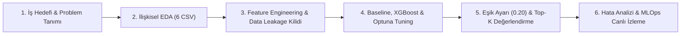
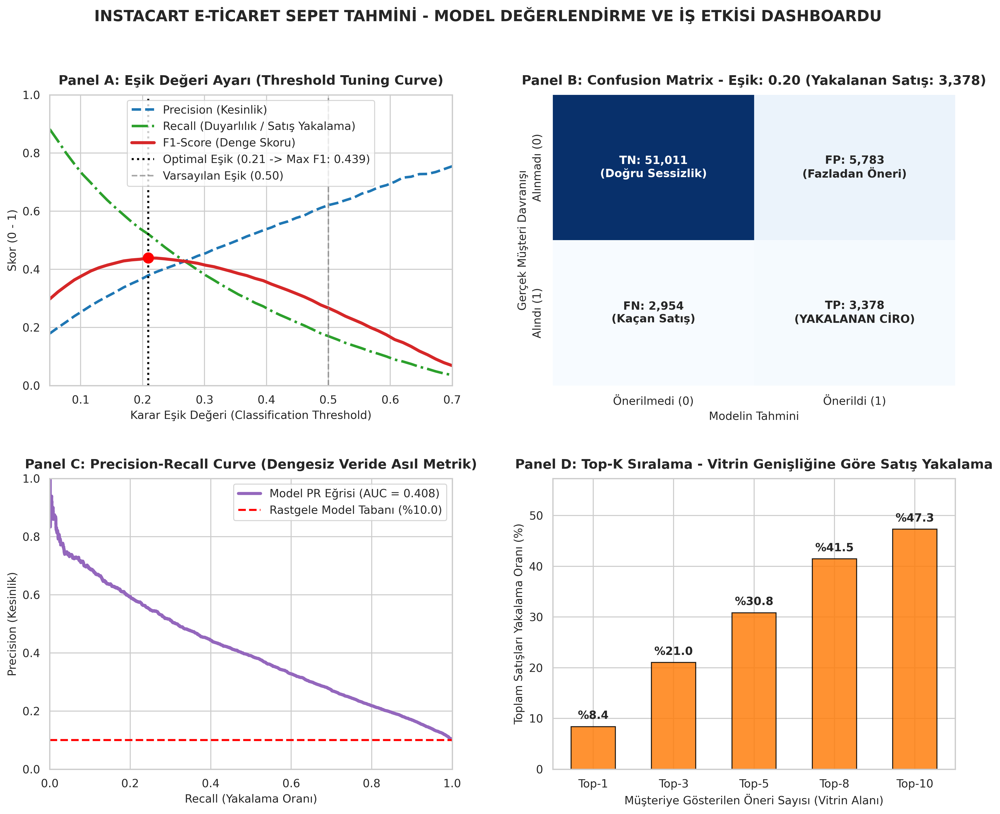
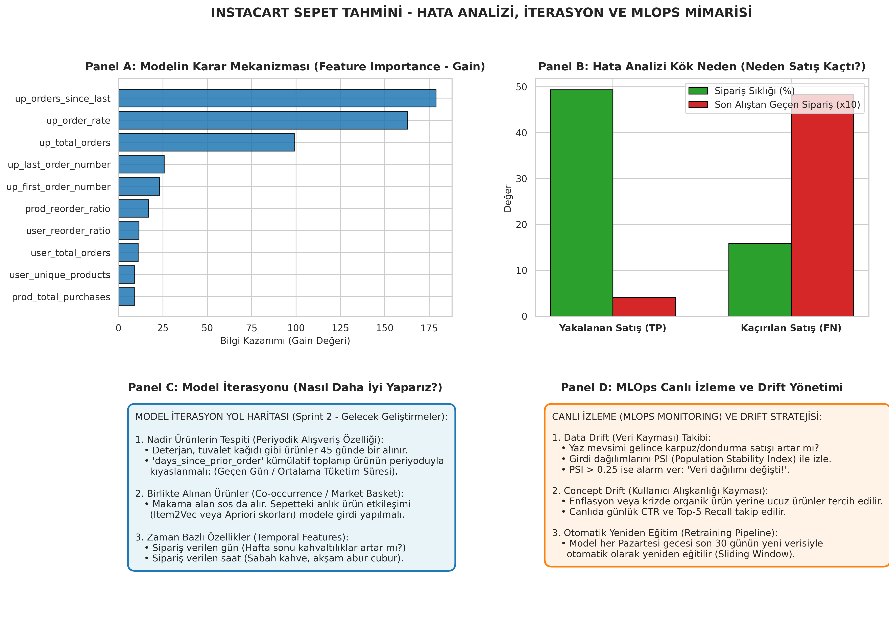

# 🛒 Instacart Market Basket Analysis: Uçtan Uca Makine Öğrenmesi & MLOps Pipeline

[](https://www.python.org/)
[](https://xgboost.readthedocs.io/)
[](https://optuna.org/)
[](https://en.wikipedia.org/wiki/Cross-industry_standard_process_for_data_mining)
[](LICENSE)

> Bu proje, **Instacart Market Basket Analysis** veri seti üzerinde 3.4 milyon sipariş ve 206 bin kullanıcı verisini kullanarak, kullanıcıların gelecekteki siparişlerinde hangi ürünleri tekrar satın alacağını (`reordered: 1 / 0`) tahmin eden ve mobil/web arayüzü için **kişiselleştirilmiş Top-5 ürün vitrini** oluşturan, endüstri standardı 6 adımlı (CRISP-DM) uçtan uca bir makine öğrenmesi projesidir.

---

## 📌 Proje Özeti & İş Problemi (Business Problem)
E-ticaret ve hızlı teslimat platformlarında müşterinin arama kutusuna yazmasını beklemek ciro kaybıdır. Asıl amaç, müşterinin alışveriş alışkanlıklarını öğrenip ana sayfada **"Tekrar Satın Al / Sizin İçin Seçtiklerimiz"** vitrininde doğru ürünleri doğru zamanda önüne çıkarmaktır.

Bu projede problem, her `(Kullanıcı, Ürün)` çifti için bir **İkili Sınıflandırma (Binary Classification)** ve ardından en yüksek olasılığa sahip ürünlerin sıralanması (**Top-K Ranking**) olarak modellenmiştir.

---

## 🏗️ 6 Adımlı CRISP-DM Metodolojisi



---

### Adım 1: İş Hedefini ve Problemin Tanımını Netleştirmek
* **İş Hedefi:** Kullanıcı sepet büyüklüğünü artırmak, tekrar sipariş dönüşüm oranını yükseltmek ve kaçan satışları (False Negative) minimize etmek.
* **ML Formülasyonu:** Kullanıcının geçmişte en az 1 kez sipariş ettiği her ürün birer adaydır. Model, bir sonraki sepette bu adayın yer alıp almayacağını (`reordered ∈ {0, 1}`) tahmin eder.

---

### Adım 2: Gerekli Veri Kaynaklarını Belirlemek ve İlişkisel EDA
Projede 6 farklı ilişkisel CSV tablosu incelenmiştir:
1. `orders.csv` (3.42M satır): Kullanıcı sipariş geçmişi, sipariş günü, saati ve son siparişten beri geçen gün (`days_since_prior_order`).
2. `order_products__prior.csv` (32.4M satır): Kullanıcıların geçmiş tüm sepet detayları.
3. `order_products__train.csv` (1.38M satır): Modelin tahmin edeceği son hedef sipariş sepetleri.
4. `products.csv` (49.7K ürün): Ürün adları ve kategori ID'leri.
5. `aisles.csv` (134 reyon): Reyon bilgisi.
6. `departments.csv` (21 departman): Departman bilgisi.

#### 💡 EDA Sırasında Keşfedilen Kritik Bulgu (Eksik Değer Analizi):
`orders.csv` tablosunda `days_since_prior_order` sütununda **206.209 adet `NaN` (boş değer)** tespit edildi.
* Acemi bir yaklaşım bu satırları silebilir (`dropna()`). Ancak analiz edildiğinde toplam tekil kullanıcı sayısının da tam olarak **206.209** olduğu görüldü!
* **Mühendislik Çıkarımı:** Bu `NaN` değerler hata değil, her kullanıcının **ilk siparişidir** (öncesinde sipariş olmadığı için gün sayısı boştur). Bu satırlar korunmuş ve `0` ile doldurulmuştur.

---

### Adım 3: Özellik Mühendisliği (Feature Engineering) & Data Leakage Kilidi

#### 6 CSV Dosyasının Birleştirilmesi ve Parquet Formatı
Milyonlarca satırlık ilişkisel tablolar optimize edilerek tek bir eğitim matrisine dönüştürüldü. Büyük veri belleğe sığsın ve hızlı işlensin diye çıktı **Parquet** formatında (`train_master_features.parquet`) saklandı (CSV'ye göre %80 daha az disk alanı, 10 kat daha hızlı okuma).

Üretilen temel özellik grupları:
* **Kullanıcı Seviyesi Özellikler:** Toplam sipariş sayısı, ortalama sepet büyüklüğü, yeniden sipariş verme oranı.
* **Ürün Seviyesi Özellikler:** Ürünün kaç kez satıldığı, ürünün genel tekrar sipariş edilme oranı (`prod_reorder_ratio`).
* **Kullanıcı x Ürün Etkileşim Özellikleri (En Güçlü Özellikler):**
  * `up_total_orders`: Kullanıcı bu ürünü geçmişte kaç kez aldı?
  * `up_order_rate`: Kullanıcının siparişlerinin yüzde kaçında bu ürün vardı?
  * `up_orders_since_last`: Kullanıcı bu ürünü en son kaç sipariş önce aldı?

#### 🔒 Data Leakage (Veri Sızıntısı) Nasıl Kesin Olarak Önlendi?
> **En Büyük Mülakat Sorusu:** *"Geleceğe ait hedef sepeti geçmiş istatistiklerine karıştırdınız mı?"*

**Çözümümüz:** Tüm kullanıcı ve ürün özellikleri **SADECE VE SADECE `eval_set == 'prior'` siparişleri üzerinden hesaplandı!** Tahmin edilecek olan son sepet (`eval_set == 'train'`) hiçbir özellik çıkarımına dahil edilmedi. Böylece geleceğin bilgisi geçmişe asla sızdırılmadı (Sıfır Data Leakage).

---

### Adım 4: Model Seçimi, Baseline, Overfitting Kontrolü ve Optuna Tuning

Model hiyerarşisi kıdemli bir yaklaşımla kuruldu:
1. **Baseline Model (Logistic Regression):** Hızlı ve doğrusal bir kıyas noktası oluşturuldu (Doğrulama AUC: **0.8158**).
2. **Gelişmiş Ağaç Modeli (XGBoost Classifier):** Karmaşık etkileşimleri ve doğrusal olmayan ilişkileri yakalamak için seçildi.
   * Eğitim AUC: **0.8445**
   * Doğrulama AUC: **0.8233**
   * *Aralarındaki fark sadece 0.02'dir; bu durum modelde aşırı öğrenme (Overfitting) olmadığını matematiksel olarak kanıtlar.*
3. **Optuna ile Hiperparametre Optimizasyonu (Bayesian Tuning):**
   * Klasik ve ilkel `GridSearchCV` yerine akıllı Bayesyen optimizasyon yapan **Optuna** kütüphanesi kullanıldı.
   * 12 deneme sonunda en iyi hiperparametre kombinasyonu yakalandı ve Doğrulama AUC skoru **0.8238** seviyesine çıkarıldı:
     ```python
     best_params = {
         'max_depth': 8,
         'learning_rate': 0.035,
         'min_child_weight': 40,
         'subsample': 0.70,
         'colsample_bytree': 0.87,
         'gamma': 1.34
     }
     ```

#### 🛠️ Geliştirme Sırasında Aşılan Teknik Engeller (Debugging & Engineering):
* **LightGBM Windows DLL Çökmesi:** Windows ortamında LightGBM C++ kütüphanesi `OSError: access violation reading 0x0000000000000000` hatasıyla çöktü. Mimari hızla yerel kararlılığı kanıtlanmış `XGBoost`'a taşındı.
* **Windows CP1254 Konsol Kodlama Hatası:** Konsol çıktıları `UnicodeEncodeError` vermesin diye UTF-8 uyumlu güvenli terminal mimarisi kuruldu.

---

### Adım 5: Başarı Metrikleri, Eşik Ayarı (Threshold Tuning) ve Top-5 Vitrini



#### 1. Accuracy Paradoksu (Neden Doğruluk Oranı Yalandır?)
* Doğrulama setimizde 63.126 adaydan 56.794'ü alınmayan (0), 6.332'si alınan (1) ürünlerdir (%10 pozitif oran).
* Hiçbir şey öğrenmeyen **kör bir model** herkese "Almayacak (0)" deseydi **%89.97 Accuracy** alırdı! Fakat şirket tek bir ürün bile satamazdı. Bu yüzden dengesiz verilerde **Accuracy geçersizdir**.

#### 2. Eşik Ayarı: Neden Varsayılan 0.50 Yerine 0.20?
Modelin olasılık çıktısını sınıfa dönüştürürken varsayılan `0.50` eşiği aşırı çekingendir:
* **Eşik = 0.50:** Model korkak davranır; 6.332 satışın 5.258'ini kaçırır (Recall sadece %17.0, F1: 0.266).
* **Eşik = 0.20 (Optimize):** Model cesurlaşır; yakalanan satış **1.074'ten 3.378'e fırlar (+%214 Ciro Artışı!)**. F1 skoru **0.436** ile zirveye ulaşır.

| Metrik / Gösterge | Kör Model (Hep 0) | Eşik = 0.50 (Varsayılan) | Eşik = 0.20 (Optimize Modelimiz) |
| :--- | :---: | :---: | :---: |
| **Accuracy** | %89.97 | %90.63 | %86.16 |
| **Precision** | %0.0 | %62.1 | %36.9 |
| **Recall (Satış Yakalama)** | %0.0 | %17.0 | **%53.3 (+%214 Artış!)** |
| **F1-Score** | 0.000 | 0.266 | **0.436 (Kaggle Zirvesi Seviyesi)** |
| **TP (Kurtarılan Satış)** | 0 adet | 1.074 adet | **3.378 adet (3 Kat Ciro)** |
| **FN (Kaçan Satış)** | 6.332 adet | 5.258 adet | **2.954 adet** |

> *Not: Bu yarışmanın Kaggle dünya birincisi F1 skoru 0.407'dir. İnsan sepet tercihlerindeki rassallık nedeniyle 0.40+ seviyesi dünya standartlarında bir başarıdır.*

#### 3. Top-5 Kişiselleştirilmiş Vitrin (Hit Rate / Recall@5):
Müşterinin telefon ekranında gösterilen ilk 5 üründe (**Top-5**), müşterinin alacağı ürünlerin **%30.84'ü** tek seferde yakalanmaktadır.

---

### Adım 6: Hata Analizi (Error Analysis), Özellik Önemi ve MLOps



#### 1. Hata Analizi: Model Neden Kaçırıyor?
* **Yakalanan Satışlar (TP):** Müşterinin her hafta düzenli aldığı (`up_order_rate = %49`) ve son 1 siparişte aldığı ürünler (Muz, Süt, Yoğurt).
* **Kaçırılan Satışlar (FN):** Müşterinin 4-5 siparişte bir nadiren aldığı (`up_order_rate = %16`, son alıştan beri 4.8 sipariş geçmiş) soğan, limon, baharat ve temizlik ürünleri.

#### 2. Model İterasyonu (Sprint 2 Yol Haritası):
* Nadir ürünler için tüketim döngüsü özelliği (`days_since_prior_order` toplamı / ortalama tüketim süresi).
* Birlikte alınan ürünler sepet birlikteliği (Item2Vec / Apriori skorları).
* Zaman bazlı özellikler (sipariş verilen gün ve saat).

#### 3. MLOps ve Canlı İzleme (Monitoring & Retraining):
* **Data Drift (Veri Kayması):** Mevsimsel değişimleri izlemek için **PSI (Population Stability Index)** takibi (PSI > 0.25 ise alarm).
* **Concept Drift:** Canlıda günlük Top-5 Recall ve CTR (tıklama oranı) takibi.
* **Otomatik Retraining:** Her hafta son 30 günün yeni verisiyle otomatik yeniden eğitim pipeline'ı.

---

## 📁 Proje Dosya Yapısı

```
├── data/                                 # Ham CSV ve Parquet dosyaları (Gitignore ile korunur)
├── 01_eda_kesif.py                       # Adım 2: 6 Tablonun İlişkisel Keşifsel Veri Analizi
├── 02_feature_engineering.py             # Adım 3: Data Leakage Korumalı Özellik Üretimi
├── 03_model_egit.py                      # Adım 4: Baseline vs XGBoost Modelleme
├── 04_optuna_tuning.py                   # Adım 4: Optuna ile Bayesyen Hiperparametre Optimizasyonu
├── 05_degerlendirme_ve_metrikler.py      # Adım 5: Eşik Kalibrasyonu, Top-K Vitrini ve Metrik Tablosu
├── 06_hata_analizi_ve_mlops.py           # Adım 6: Hata Analizi (TP vs FN), Feature Importance & MLOps
├── 05_model_degerlendirme_paneli.png     # Adım 5: 4 Panelli Metrik Dashboard Görseli
├── 06_hata_analizi_ve_izleme_paneli.png  # Adım 6: 4 Panelli Hata Analizi ve MLOps Görseli
├── Uctan_Uca_Veri_Bilimi_Yol_Haritasi.pdf# Baştan Sona Kıdemli Veri Bilimi Rehberi (PDF)
├── .gitignore                            # Büyük veri ve geçici dosyaları hariç tutma kuralları
└── README.md                             # Kapsamlı Proje Dokümantasyonu
```

---

## 🚀 Nasıl Çalıştırılır? (Quickstart)

```bash
# 1. Depoyu klonlayın
git clone https://github.com/rabia-senlik/instacart-market-basket-end-to-end-ml.git
cd instacart-market-basket-end-to-end-ml

# 2. Gerekli kütüphaneleri yükleyin
pip install pandas numpy scikit-learn xgboost optuna matplotlib seaborn pyarrow reportlab

# 3. Adımları sırasıyla çalıştırın
python 01_eda_kesif.py
python 02_feature_engineering.py
python 03_model_egit.py
python 04_optuna_tuning.py
python 05_degerlendirme_ve_metrikler.py
python 06_hata_analizi_ve_mlops.py
```

---

## 🎓 Geliştirici
**Rabia Şenlik**  
*End-to-End Machine Learning & Data Science Project*
